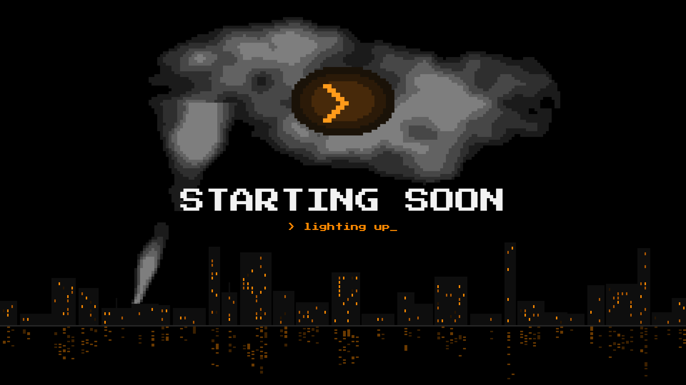
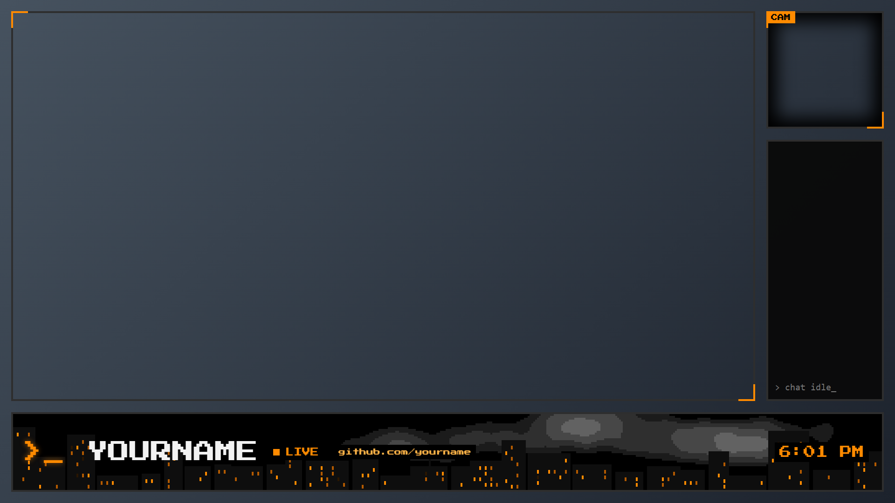

# Smoke Overlay

A free, pixel-art stream overlay for OBS: drifting smoke, a night skyline, a bottom bar, a Twitch chat box and
"starting soon / be right back / ending" screens. It is one HTML file you add to OBS as a browser source. No GPU use to speak of.

## Set up (5 minutes)

1. Download this folder. Open `config.js` and set `CHANNEL` (your Twitch login, lowercase), `TITLE`, and `LINK`.
2. In OBS add a **Browser** source to a scene, tick **Local file** off, and paste the address for the look you want
   (change the folder to where you put it). Set **Width 1920, Height 1080**, and turn on **Custom frame rate: 15**.

   `file:///C:/path/to/smoke-overlay/overlay.html?v=main`

3. Put your game or screen capture and your webcam underneath it, matching the frames the overlay draws.

| `?v=` | Use for |
|---|---|
| `main` | screen on the left, cam and chat on the right, bottom bar |
| `nocam` | screen and chat, no camera |
| `cam` | big camera with a small screen thumbnail |
| `dual`, `dualcam`, `dualterm` | two screens or terminals side by side |
| `starting`, `brb`, `ending`, `private` | full-screen scenes |
| `haze` | a thin, transparent smoke layer to put over a camera |
| `clean` | just a thin frame |

## Smoke scene transition

`smoke-transition.webm` is a smoke wipe with transparency. In OBS, add a **Stinger** transition, pick that file, and set the
**Transition point** to about 750 ms. To make a different one, run `make_smoke_transition.py` (needs Python, numpy and ffmpeg).

## Optional

Put an `avatar.png` next to `overlay.html` to show a round avatar in the bar. Without it the bar simply has none.

## Notes

- The chat box reads your public Twitch chat with no login. It hides links and obvious spam from the overlay, and removes
  banned users' messages. It does not change anything on Twitch.
- Fonts: Press Start 2P, under the SIL Open Font License (see `OFL.txt`).
- License: MIT (see `LICENSE`). Credit is appreciated, not required.
